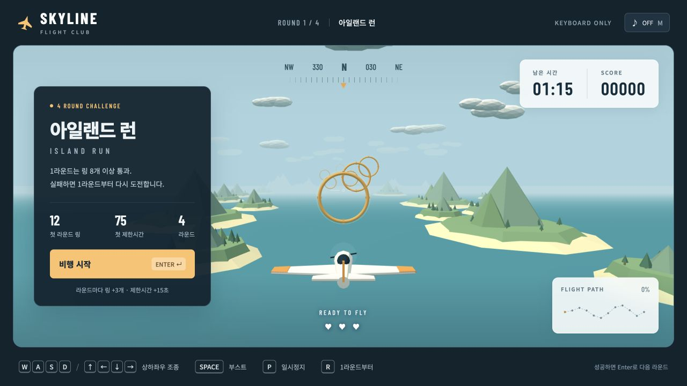

# SKYLINE — 아일랜드 런

마우스 없이 WASD 또는 방향키로 즐기는 3D 아케이드 비행 게임입니다. 섬 사이를 비행하며 황금빛 링을 통과하세요.

[바로 플레이하기](https://skyline-flight-ns1001.youcandoitsion.chatgpt.site) · [소스 코드](https://github.com/sioninzion/skyline-flight)



## 조작

| 키 | 기능 |
| --- | --- |
| Enter | 시작 / 계속 / 성공 후 다음 라운드 / 실패 후 1라운드부터 재도전 |
| W 또는 ↑ | 상승 |
| S 또는 ↓ | 하강 |
| A 또는 ← | 왼쪽 이동 |
| D 또는 → | 오른쪽 이동 |
| Space | 부스트 — 누르고 있는 동안 가속 |
| P 또는 Esc | 일시정지 / 계속 |
| R | 점수를 초기화하고 1라운드부터 다시 시작 |
| M | 소리 켜기 / 끄기 |

비행기는 자동으로 전진합니다. 다른 창으로 이동하면 자동으로 일시정지됩니다.

## 게임 규칙

총 4라운드입니다. 1라운드는 기존 코스 그대로이며, 이후 라운드는 다른 경로와 추가 링으로 구성됩니다.

| 라운드 | 링 | 제한시간 | 최소 통과 목표 |
| --- | --- | --- | --- |
| 1 | 12개 | 75초 | 8개 |
| 2 | 15개 | 90초 | 10개 |
| 3 | 18개 | 105초 | 12개 |
| 4 | 21개 | 120초 | 14개 |

- 라운드 성공 후 Enter를 누르면 다음 라운드로 이어집니다. 4라운드까지 성공하면 전체 도전이 끝납니다.
- 점수는 라운드 사이에 누적되며, 각 라운드 시작 시 생명과 부스트가 회복됩니다.
- 시간 초과, 세 번의 바다 충돌, 통과 목표 미달로 실패하면 Enter로 1라운드부터 다시 시작합니다. 재도전과 R 재시작은 점수와 진행을 초기화합니다.
- 링을 통과하면 2초를 얻고, 놓치면 5초가 줄어듭니다.
- 연속 통과하면 최대 5배까지 점수 보너스를 받습니다. 링 정중앙 통과는 추가 점수를 줍니다.
- 부스트는 사용하지 않을 때 자동으로 충전됩니다.
- 바다에 닿으면 기체가 복구되며 생명이 하나 줄어듭니다. 세 번 닿으면 비행이 끝납니다.
- 최고 점수는 해당 브라우저에 저장됩니다.

## 로컬 실행

빌드나 npm 패키지 설치 없이 실행합니다. Python 3와 WebGL을 지원하는 최신 브라우저가 필요합니다.

```sh
git clone https://github.com/sioninzion/skyline-flight.git
cd skyline-flight
python3 -m http.server 8000 --bind 127.0.0.1
```

브라우저에서 <http://127.0.0.1:8000>을 열고 Enter를 누르세요. JavaScript 모듈을 사용하므로 HTML 파일을 직접 여는 대신 위의 로컬 서버를 이용합니다.

## 파일 구성

| 파일 | 역할 |
| --- | --- |
| `index.html` | 게임 화면과 조작 안내 |
| `style.css` | 화면 배치 및 반응형 스타일 |
| `game.js` | 3D 장면, 키보드 입력, 화면 표시, 효과음 |
| `flight.js` | 비행 이동, 링 판정, 점수와 게임 상태 |
| `vendor/three.module.js` | 번들된 Three.js 0.160.0 |
| `vendor/THREE-LICENSE.txt` | Three.js MIT 라이선스 |
| `tests/flight.test.mjs` | 이동, 부스트, 판정 및 완주 검증 |

라운드별 링·시간·통과 목표는 `flight.js`의 `ROUNDS`에서, 기본 경로는 `ROUTE`에서, 조작과 3D 장면은 `game.js`에서 수정할 수 있습니다. Google Fonts는 온라인일 때 불러오며, 연결이 없으면 기본 글꼴을 사용합니다.

## 게임 로직 검증

Node.js 22 이상에서 실행합니다.

```sh
node tests/flight.test.mjs
```

이동, 부스트, 일시정지, 4라운드 순차 진행, 누적 점수, 전체 완주, 2–4라운드에서 실패한 뒤 1라운드로 초기화되는 동작을 검증합니다.

## 외부 라이브러리

Three.js의 라이선스는 [`vendor/THREE-LICENSE.txt`](vendor/THREE-LICENSE.txt)에 포함되어 있습니다.
